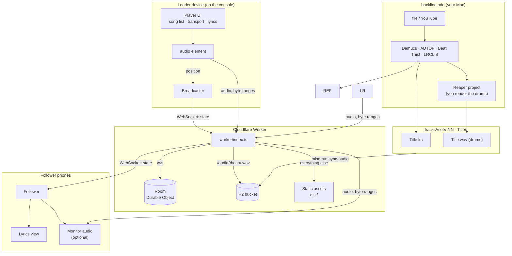
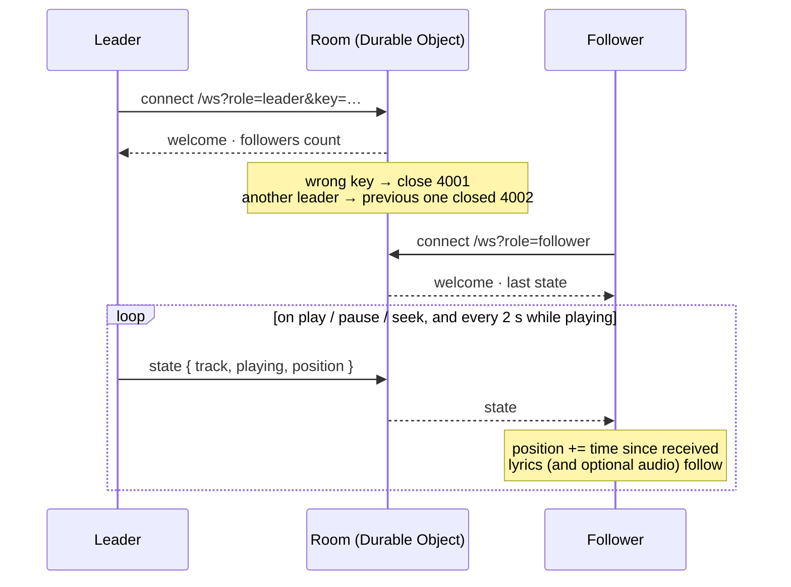

# Backline

Everything a band needs behind it. Two halves in one repo:

- **The player** — a web app on one phone (the *leader*, plugged into the console) plays the
  backing track; everyone else opens the same address and follows the lyrics live. Works
  offline once the tracks are downloaded.
- **The importer** — `backline add <song>` turns an audio file or a YouTube link into a Reaper
  project: the drums transcribed to MIDI with your drum instrument on the track, a count-in,
  and the lyrics as markers on the ruler. From then on **the Reaper project is the source**:
  you fix the drums and the lyrics there, render, and `backline export` updates the song folder.

```bash
backline add "https://www.youtube.com/watch?v=flr8vDQ9Wuc"
# open the Reaper project it prints: edit, save, File → Render
backline export "~/Music/Backline/jobs/Juanes - Fotografia (4b74e33d)"
mise run sync-audio
mise run deploy
```

Each song folder holds two files on **one timeline** — two bars of count-in, then the song:

```
tracks/Cumple de Guille/02 - Fotografía/
├── Fotografia.lrc      lyrics, one line per marker; the count-in shows as a countdown, 1 2 3 4 · 1 2 3 4
├── Fotografia.wav      the drums (your instrument, rendered from Reaper)
└── backline.json       where it came from, tempo, count-in, where the lyrics came from
```

The band plays to the drums and reads the lyrics; the leader's phone plays the file as it is.

## Setup

[mise](https://mise.jdx.dev) installs everything: Node 22, Python 3.12, uv, ffmpeg, yt-dlp,
and the JS and Python dependencies.

```bash
git clone … backline && cd backline
mise install
backline doctor         # the importer's tools, packages and GPU
```

Model weights (~80 MB Demucs, ~78 MB Beat This!) download on the first `backline add`.

## Adding a song

```bash
backline add <audio-file | URL> [--set "Cumple de Guille"] [--number 3]
```

1. **Analysis** (~20 s on an M-series Mac): Demucs separates drums and vocals, ADTOF
   transcribes the drums, Beat This! finds the beat and the first downbeat, lyrics come from
   [LRCLIB](https://lrclib.net) and are checked against the isolated vocal.
2. **The project** `~/Music/Backline/jobs/<Artist - Title (hash)>/<Title>.RPP` is written
   once: the drums as MIDI with your instrument loaded, the song muted underneath, the count-in,
   and every lyric line as a marker. **The song folder** `tracks/<set>/<NN - Title>/` gets
   `Title.lrc` and `backline.json` right away. The set comes from `--set` or `backline.toml`;
   the number from `--number` or the next free one. A song that was already imported from the
   same URL or file is recognised by `backline.json` and its folder reused, whatever title or
   set you pass; renumber by renaming the folder.
3. **Reaper.** Open the project, fix what needs fixing — drum hits, and the lyrics: drag a
   marker to re-time a line, double-click it to change the words, add or delete markers —
   save, File → Render. The dialog is pre-filled to put `Title.wav` in the song folder.
4. `backline export <job>` reads the markers back from the saved project and rewrites
   `Title.lrc`. Run it whenever you touched the lyrics.
5. `mise run sync-audio` uploads the WAV to R2 and updates `tracks/audio.json`;
   `mise run deploy` publishes.

### Options

```
--set NAME            set (tab) to add the song to; default from backline.toml
--number N            position in the set; default: next free
--to DIR              an explicit song folder instead of tracks/<set>/<NN - Title>
--artist / --title    override what was read from tags, the YouTube title, or the file name
--lyrics-file FILE    use your own .lrc/.txt instead of looking lyrics up
--lyrics-offset SEC   shift the lyrics by hand (skips the automatic check)
--no-lyrics
--count-in BARS       default 2 (backline.toml); 0 = none
--grid MODE           auto (default) | straight | tracked — see The beat grid
--bpm N               force a straight grid at this tempo
--quality fast|best   Demucs htdemucs (default) or htdemucs_ft (~4× slower)
--force               ignore the cache and rerun every stage

backline export <job>                         song folder from the saved project (markers → .lrc)
backline resimplify <job> [--count-in 0 … --overwrite]   regenerate MIDI (and the project, if it is still ours) from the cached analysis
backline lyrics <job> [--artist … --title … --offset …]   look the lyrics up again and swap the project's markers
backline rename <job> --title … [--artist …]  fix the name everywhere: job, project, song folder, files (render included)
backline fx-template <Title.RPP>              remember your drum VSTi
backline doctor
```

Inputs: wav, mp3, m4a, aac, flac, aiff, ogg, opus, or any URL `yt-dlp` understands.

Got the name wrong? `backline rename <job> --title "Ironic"` renames the job, the project, the
song folder (keeping its number) and every file in it — the rendered `.wav` included — and
regenerates the outputs, so nothing needs re-rendering. Lyrics not found or wrong?
`backline lyrics <job> --artist … --title …` redoes the lookup and swaps the markers in the
project (close it in Reaper first; nothing else in it is touched); `--offset -0.3` shifts
them by hand. A lookup that finds nothing leaves the markers alone.

### The job folder

Everything that is not a deliverable lives outside the repo, in `~/Music/Backline/jobs/`:

```
Juanes - Fotografia (4b74e33d)/
├── Fotografia.RPP         the Reaper project
├── input/                 source.webm (or your file), source.json, original.wav
├── work/                  stems, activations, beats, notes, lyrics.json — disposable
└── output/                Fotografia.mid, Fotografia (daring).mid
```

Every stage is cached there, so re-running is instant and `resimplify`/`lyrics` only redo
what changed.

**One project per song, and once Reaper has saved it, it is the source.** `backline` then
reads it (`export`) or swaps its lyric markers (`lyrics`), but never regenerates it on its
own: `resimplify` still writes fresh MIDI to `output/` for you to import, and only
`--overwrite` replaces the project — with your edits.

### The Reaper project

| Track | Content | Pan | State |
|---|---|---|---|
| `<Title> (drums)` | the real drums (Demucs stem) | hard left | muted — unmute to compare |
| `<Title> (MIDI conservative)` | the drums as MIDI, count-in first | centre | on, your VSTi loaded |
| `<Title> (MIDI daring)` | same, more sensitive detection | centre | muted, your VSTi loaded |
| `<Title> (original)` | the song | right | muted — unmute to play along |

File → Render is pre-filled: the song folder, `<Title>.wav`, 24-bit 44.1 kHz, whole project —
so the render is the drums, count-in included.

**The lyrics are the markers.** The project starts with one marker per line — eight for the
countdown (`1 2 3 4 · 1 2 3 4`), then the lines LRCLIB knew — on the project timeline, which is
the `.lrc` timeline. Drag one to re-time a line, double-click to edit the words, insert one
(`M` at the play cursor) for a line that is missing, delete one that is wrong; the
Region/Marker Manager lists them all. `backline export` turns every plain marker into a line of
`Title.lrc`, in time order; regions are ignored, so you can still use those for sections.

### The beat grid

A perfectly regular grid where the song allows it. Studio recordings
are almost always played to a click, so one tempo fits every drummed beat within a few
milliseconds — and that line, extrapolated, is right through the intro and the breaks where a
beat tracker follows the strumming instead. So: the beats the tracker is confident about (drums
playing, regular spacing) get a straight-line fit; if 95 % of them are within 35 ms the whole song
gets a perfectly regular grid at the fitted tempo (Ironic: 85.30 bpm, the intro dead straight).
If the fit is loose — a recording that breathes, like *Don't Get Me Wrong* — the cleaned,
smoothed tracked beats are used instead. `backline.json` reports it: `grid.mode`
(straight / tracked / manual), `bpm`, fit residuals, beats dropped or inserted. Override with
`--bpm 85.3` (force a straight grid at that tempo) or `--grid tracked`.

The same grid sets the count-in, the MIDI tempo and the Reaper project tempo, so for a straight
song Reaper's bar lines land on the song's bars and the count-in ends exactly on the first
downbeat.

*Conservative vs daring:* the conservative MIDI uses the transcriber's default thresholds and
rarely invents hits but is shy on toms and cymbals; the daring one lowers the thresholds and
catches more at the cost of some false positives, which come in quiet because velocity follows
confidence. GM notes: kick 36, snare 38, toms 45, hi-hat 42, cymbals 49, count-in 37.

### Your drum instrument

Once: open a generated project, put your drum VSTi on the MIDI track, pick the kit, save, then

```bash
backline fx-template "~/Music/Backline/jobs/<job>/<Title>.RPP"
```

The chain (plugin and state, kit included) is stored in `~/.config/backline/midi-track.RfxChain`
and loaded on both MIDI tracks of every project from then on.

### Lyrics

The song is identified from `--artist/--title`, the file's tags, the YouTube title and
channel, or the file name, and looked up on LRCLIB (open, no account). Candidates are ranked by
name similarity, duration and whether they are time-synced. The result is checked against the
isolated vocal: a gross mismatch (a music video with a longer intro than the album cut) is
corrected with a constant shift; small disagreements are left alone because LRC lines are
conventionally tagged a touch early. `work/lyrics.json` records what was considered and why.
Studio recordings only — a live or cover version gets the right words at the wrong times.

### `backline.toml`

```toml
[paths]
jobs = "~/Music/Backline/jobs"   # input/, work/ and the project; big, not in git
tracks = "tracks"                # the song folders, relative to this file

[tracks]
default_set = "Cumple de Guille"

[count_in]
bars = 2
note = 37
```

## Using the player

Everyone opens the same URL and starts as a follower.

### Leader

1. Tap **Lead** at the top and enter the leader key. The device switches to the player.
2. **Tap a song** to load it. The leader never streams: a song that is not on the device yet is downloaded first (the row shows *Downloading 42 %*; songs not yet downloaded are marked), then loaded. Nothing plays yet; the transport appears at the bottom and, if the song has lyrics, they open. **‹ Songs** goes back to the list (on an iPad the list and the lyrics sit side by side).
3. **Play** starts the track, or resumes from where you paused. **Pause** keeps the position. **Restart** goes back to the top; if it was playing it keeps playing.
4. To jump somewhere, **tap a lyric line** and playback moves to it, or **tap or drag the progress bar** (the time shows where you'll land; it seeks when you let go). Followers jump along. Scrolling the lyrics never seeks, and the list stops auto-scrolling for a few seconds while you read ahead.
5. Loading another song unloads the current one. When a track ends it rewinds and waits.

The chips at the top show status: **Offline · xx MB** (all tracks stored on the device) or **Download N tracks** (tap to store them all at once), **Awake** (screen won't lock), and **Leader · N** (connected, N followers; it reads **Leader · offline** when the room can't be reached). Tap **Leader** to step down.

There is only one leader. If a second device enters the key, the first one drops back to following and says so. The leader keeps playing with no internet; followers keep running on the last position they heard and catch up as soon as it is back.

### Followers

Open the address, that's it. The current song and the highlighted line follow the leader. **Live** means connected; **Leader offline** means the leader lost its connection and the lyrics keep running on the last known position. Tap once so the screen stays awake.

Tap **Muted** to hear the drums track on this device too. It starts, pauses, and restarts with the leader and stays within a fraction of a second of it; there is no transport, the leader drives. Tap **Listening** to mute again. Nothing is downloaded while muted; listening streams the full WAV (about 10 MB per minute), which is worth knowing on cellular. If the chip says **Tap to listen**, the browser refused to start audio on its own; tapping it again fixes that.

### Leader key

The default key is `goodkarma`, set in `wrangler.jsonc`. To change it without committing anything:

```
npx wrangler secret put LEADER_KEY
```

Devices holding the old key are refused on their next connection and go back to following.

## Setting up the devices for a gig

Leader (iPhone or iPad on the console):

1. Open the site in Safari, then Share → **Add to Home Screen**. Launch it from the icon from now on.
2. Tap **Lead** and enter the key.
3. Tap **Download N tracks** while on Wi-Fi. When it reads **Offline · xx MB**, every track is on the device and playback works with no connection. After new songs are deployed, the chip shows how many are missing; tap it again.
4. Tap any song once. The chip switches to **Awake**. If it says **Can't keep awake**, tap once more; if it still does, set Settings → Display & Brightness → Auto-Lock → Never for the gig.
5. Optional: Settings → Accessibility → Guided Access locks the device to this app.
6. Plug into the console with a USB-C (or Lightning) audio adapter or interface. Audio plays regardless of the ring/silent switch.

Followers: open the address, tap once. Following needs internet (venue Wi-Fi or cellular); playback on the leader does not.

When a new version has been deployed, an **Update available** pill appears. Tap **Reload** between songs, not during one.

## Tracks

One folder per song inside `tracks/`, grouped in set folders. `backline add` creates them, but
any folder with the right files works:

```
tracks/
└── Cumple de Guille/
    ├── 01 - No podrás/
    │   ├── NoPodras.wav
    │   └── NoPodras.lrc
    └── 02 - Fotografía/
        ├── Fotografia.wav
        └── Fotografia.lrc
```

- A leading number controls the order and is stripped from the name shown. The folder name is the song title.
- Set folders become tabs. With a single set the tabs are hidden.
- Each song folder holds one `.wav` (what the band plays to) and optionally one `.lrc`/`.txt`. Other files are ignored by the player; `backline.json`, written by the importer, records the origin and is committed.
- `.lrc` lyrics are timed (`[01:02.50]line`) and get the highlighted, auto-scrolling view. Untimed lines (metadata, credits) are ignored. A `.txt` is shown as plain scrollable text.

The WAV files are not committed; `mise run sync-audio` hashes them, uploads the missing ones to
R2 and rewrites `tracks/audio.json`, which is committed so a build anywhere knows every track.

## Running locally

Two processes: Vite for the page, Wrangler for the Worker (audio + realtime).

```
mise run sync-audio -- --local   # put the WAVs into the local R2 used by wrangler dev
mise run dev:worker              # worker on http://localhost:8787
mise run dev                     # page on http://localhost:5173, proxies /audio and /ws to the worker
```

Other commands:

```
mise run typecheck    # wrangler types + tsc for the page and the worker
mise run build        # typecheck + production build in dist/
mise run preview      # build, then serve dist/ through the worker with the service worker active
mise run deploy       # sync audio + build + publish to Cloudflare
mise run check:browser   # headless Chrome run-through against a running preview
mise run test         # the importer's fast tests; test:slow runs the models end to end
mise run lint         # ruff
```

The service worker (offline support, update prompt) is only active in `preview`, not in `dev`. To try leader and follower locally, use two browser profiles (or a private window), since the role is stored per browser.

## Deploying to Cloudflare

The app is a Cloudflare Worker with static assets (`wrangler.jsonc`): the Worker streams `/audio/*` from the R2 bucket, routes `/ws` to the `Room` Durable Object, and serves everything else from `dist/`. The worker is still named `band-companion` and the bucket `band-companion-audio` — that is the deployed URL and the uploaded audio, so they stay.

First time:

```
npx wrangler login
npx wrangler r2 bucket create band-companion-audio
mise run deploy
```

After that `mise run deploy` is all that's needed. A git-connected build in the Cloudflare dashboard also works (build command `npm run build`, deploy command `npx wrangler deploy`) because `tracks/audio.json` is committed; just run `mise run sync-audio` locally whenever audio changes.

Cache headers for hashed assets and the service worker live in `public/_headers`; audio headers are set by the Worker.

## Architecture



### Realtime flow

The room keeps the last state, so late joiners are in sync immediately. Followers do not stream a position; they receive it on every change and every two seconds while playing, and run their own clock in between.



## How it works

**Importer** (`tools/backline/`, Python):

- `ingest.py` — ffmpeg, or `yt-dlp` for URLs → `input/original.wav`.
- `separate.py` — Demucs `htdemucs` on the GPU → drum and vocal stems.
- `transcribe.py` — ADTOF: five drum classes at 100 frames/s. `simplify.py` picks peaks with two threshold profiles.
- `tempo.py` — Beat This!: beats, downbeats, BPM.
- `lyrics.py` / `lrclib.py` — identification, lookup, ranking, and the vocal-stem timing check.
- `midi_out.py` — one `Sequence` (count-in, shift, note ticks) feeds both the `.mid` writer and the Reaper project, so they can never disagree.
- `reaper.py` — the practice-mix project, your FX chain, render settings; lyric markers written, read back (`read_markers`) and swapped in place (`replace_markers`) in a project Reaper has saved.
- `pipeline.py` — stages with per-job caching; `config.py` — `backline.toml` and song folders.

**Player** (`src/`, TypeScript):

- `scripts/sync-audio.mjs` hashes the WAVs, uploads them to R2 and writes `tracks/audio.json`.
- `src/tracks.ts` builds the song list from `audio.json` plus the `.lrc`/`.txt` files found with `import.meta.glob`. Audio URLs are `/audio/<hash>.wav`.
- `worker/index.ts` streams audio from R2 with byte-range support (Safari needs it) and hands `/ws` to `worker/room.ts`, a Durable Object holding one room: the leader's socket pushes `{ track, playing, position }` on every change and every two seconds while playing; follower sockets receive it, and late joiners get the last state.
- `src/sync.ts` is the client side: `Broadcaster` for the leader, `Follower` for everyone else. Followers run the position on their own clock between updates, which is plenty for lyric lines. Both reconnect with backoff and when the app returns to the foreground.
- `src/player.ts` wraps the main `<audio>` element. Playback starts synchronously inside the tap handler, which iOS requires. On the leader the element plays a `blob:` URL of the downloaded file (`src/offline.ts` `ensureCached` + `cachedBlobUrl`), never a network stream, so the service worker and its range slicing are out of the audio path.
- `src/lyrics.ts` parses LRC; `src/lyrics-view.ts` highlights and scrolls the current line every frame.
- `src/monitor.ts` is the follower's optional audio: a second `<audio>` element that loads the leader's track and seeks whenever it drifts more than half a second from the extrapolated position.
- `src/ui.ts` is the leader screen, `src/follow-ui.ts` the follower screen; `src/main.ts` mounts one or the other depending on whether the device holds a key (`src/role.ts`).
- `src/offline.ts` downloads tracks into the Cache Storage API; `src/sw.ts` (Workbox) precaches the app shell and serves cached audio, slicing it for byte-range requests.
- `src/wakelock.ts` uses the Screen Wake Lock API and re-acquires the lock when the app returns to the foreground.

Icons are in `public/icons/`. To regenerate the PNGs from the SVGs with ImageMagick:

```
cd public/icons
magick -background none -density 384 favicon.svg -resize 512x512 icon-512.png
magick -background none -density 384 favicon.svg -resize 192x192 icon-192.png
magick -background none -density 384 icon-maskable.svg -resize 512x512 icon-512-maskable.png
magick -background '#0b0b0d' -density 384 icon-maskable.svg -resize 180x180 apple-touch-icon.png
```

## Limitations

- Five drum classes: all toms are one note, crash and ride are one note, no open/closed hi-hat.
- The MIDI and the project use one tempo (the fitted one); for the few recordings that drift, the count-in and the bar lines are right at the start and slowly diverge — a per-beat tempo map is planned.
- Drum notes are not quantized yet; grid-snapped styles are planned.
- Lyrics need the song to exist on LRCLIB; originals come back "not found" (a Whisper fallback is planned).
- `yt-dlp` breaks when YouTube changes; `mise upgrade yt-dlp` fixes it.

See `docs/PLAN.md` for the importer's design and roadmap, `AGENTS.md` for working conventions.
