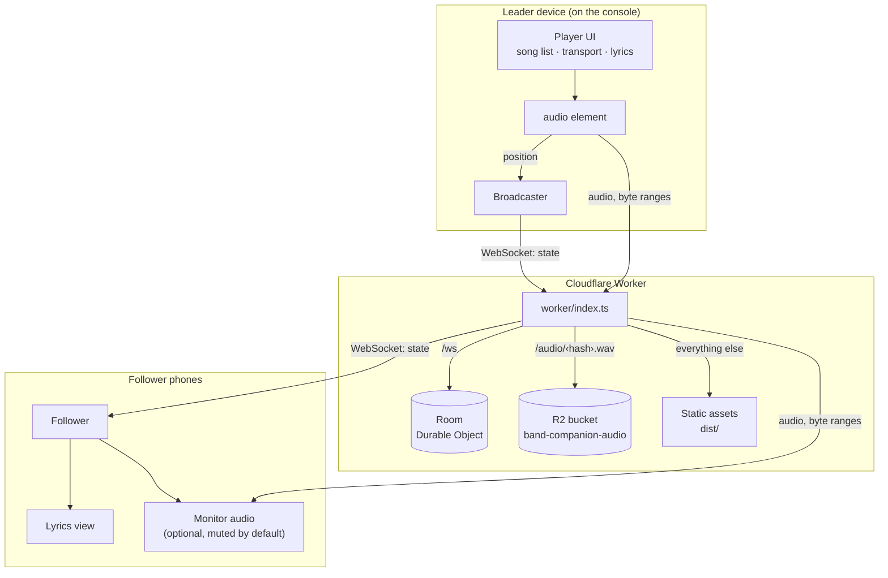
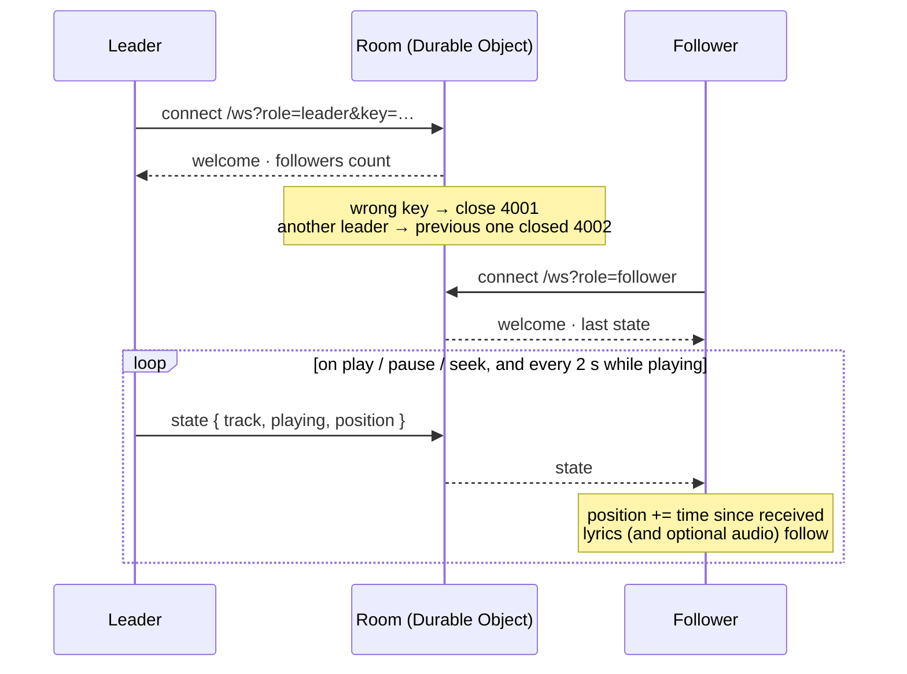
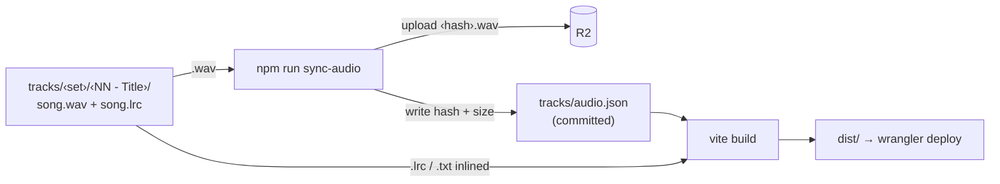

# Band Companion

A backing‑track player with live lyrics for a band. One device (the **leader**) is plugged into the console and plays the music; everyone else opens the same address and **follows** the lyrics in real time on their own phone.

It is a web app (Vite + TypeScript) that runs as a Home Screen app on iOS, backed by a small Cloudflare Worker that streams the audio and relays the playback position.

## Using it

Everyone opens the same URL and starts as a follower.

### Leader

1. Tap **Lead** at the top and enter the leader key. The device switches to the player.
2. **Tap a song** to load it. Nothing plays yet; the transport appears at the bottom and, if the song has lyrics, they open. **‹ Songs** goes back to the list (on an iPad the list and the lyrics sit side by side).
3. **Play** starts the track, or resumes from where you paused. **Pause** keeps the position. **Restart** goes back to the top; if it was playing it keeps playing.
4. To jump somewhere, **tap a lyric line** and playback moves to it, or **tap or drag the progress bar** (the time shows where you’ll land; it seeks when you let go). Followers jump along. Scrolling the lyrics never seeks, and the list stops auto‑scrolling for a few seconds while you read ahead.
5. Loading another song unloads the current one. When a track ends it rewinds and waits.

The chips at the top show status: **Offline · xx MB** (all tracks stored on the device) or **Download N tracks** (tap to store them), **Awake** (screen won’t lock), and **Leader · N** (connected, N followers; it reads **Leader · offline** when the room can’t be reached). Tap **Leader** to step down.

There is only one leader. If a second device enters the key, the first one drops back to following and says so. The leader keeps playing with no internet; followers keep running on the last position they heard and catch up as soon as it is back.

### Followers

Open the address, that’s it. The current song and the highlighted line follow the leader. **Live** means connected; **Leader offline** means the leader lost its connection and the lyrics keep running on the last known position. Tap once so the screen stays awake.

Tap **Muted** to hear the track on this device too. It starts, pauses, and restarts with the leader and stays within a fraction of a second of it; there is no transport, the leader drives. Tap **Listening** to mute again. Nothing is downloaded while muted; listening streams the full WAV (about 10 MB per minute), which is worth knowing on cellular. If the chip says **Tap to listen**, the browser refused to start audio on its own; tapping it again fixes that.

### Leader key

The default key is `goodkarma`, set in `wrangler.jsonc`. To change it without committing anything:

```
npx wrangler secret put LEADER_KEY
```

Devices holding the old key are refused on their next connection and go back to following.

## Setting up the devices for a gig

Leader (iPhone or iPad on the console):

1. Open the site in Safari, then Share → **Add to Home Screen**. Launch it from the icon from now on.
2. Tap **Lead** and enter the key.
3. Tap **Download N tracks** while on Wi‑Fi. When it reads **Offline · xx MB**, every track is on the device and playback works with no connection. After new songs are deployed, the chip shows how many are missing; tap it again.
4. Tap any song once. The chip switches to **Awake**. If it says **Can’t keep awake**, set Settings → Display & Brightness → Auto‑Lock → Never for the gig.
5. Optional: Settings → Accessibility → Guided Access locks the device to this app.
6. Plug into the console with a USB‑C (or Lightning) audio adapter or interface. Audio plays regardless of the ring/silent switch.

Followers: open the address, tap once. Following needs internet (venue Wi‑Fi or cellular); playback on the leader does not.

When a new version has been deployed, an **Update available** pill appears. Tap **Reload** between songs, not during one.

## Adding songs

One folder per song inside `tracks/`, grouped in set folders:

```
tracks/
├── 1 - First set/
│   ├── 01 - Sing Sing Sing/
│   │   ├── Sing Sing Sing.wav
│   │   └── Sing Sing Sing.lrc
│   └── 02 - In the Mood/
│       └── In the Mood.wav
└── 2 - Second set/
    └── 01 - Moonlight Serenade/
        ├── moonlight.wav
        └── lyrics.txt
```

- A leading number controls the order and is stripped from the name shown. The folder name is the song title.
- Set folders become tabs. With a single set the tabs are hidden.
- Each song folder holds one `.wav` and optionally one lyrics file. File names inside the folder don’t matter.
- `.lrc` lyrics are timed (`[01:02.50]line`) and get the highlighted, auto‑scrolling view. Untimed lines in an `.lrc` (metadata, credits) are ignored, so check the file for stray credits with a timestamp. A `.txt` is shown as plain scrollable text.

The WAV files are not committed and are not part of the build; they go to Cloudflare R2:

```
npm run sync-audio
```

This hashes every WAV, uploads the ones not yet recorded as uploaded, and writes `tracks/audio.json`, which **is** committed. Re‑exporting a song gives it a new hash, so devices notice and re‑download it. `npm run deploy` runs the sync first. (If the bucket is ever emptied, clear the `uploaded` lists in `audio.json` to force a re‑upload.)

Commit, push or deploy, done.

## Running locally

Requires Node 22.12 or newer. Two processes: Vite for the page, Wrangler for the Worker (audio + realtime).

```
npm install
npm run sync-audio -- --local   # put the WAVs into the local R2 used by wrangler dev
npm run dev:worker              # worker on http://localhost:8787
npm run dev                     # page on http://localhost:5173, proxies /audio and /ws to the worker
```

Other commands:

```
npm run typecheck   # wrangler types + tsc for the page and the worker
npm run build       # typecheck + production build in dist/
npm run preview     # build, then serve dist/ through the worker with the service worker active
npm run deploy      # sync audio + build + publish to Cloudflare
node scripts/browser-check.mjs   # headless Chrome run-through against a running preview
```

The service worker (offline support, update prompt) is only active in `preview`, not in `dev`. To try leader and follower locally, use two browser profiles (or a private window), since the role is stored per browser.

## Deploying to Cloudflare

The app is a Cloudflare Worker with static assets (`wrangler.jsonc`): the Worker streams `/audio/*` from the R2 bucket `band-companion-audio`, routes `/ws` to the `Room` Durable Object, and serves everything else from `dist/`.

First time:

```
npx wrangler login
npx wrangler r2 bucket create band-companion-audio
npm run deploy
```

After that `npm run deploy` is all that’s needed. A git‑connected build in the Cloudflare dashboard also works (build command `npm run build`, deploy command `npx wrangler deploy`) because `tracks/audio.json` is committed; just run `npm run sync-audio` locally whenever audio changes.

Cache headers for hashed assets and the service worker live in `public/_headers`; audio headers are set by the Worker.

## Architecture

One Cloudflare Worker serves everything: the static page, the audio from R2, and a WebSocket room backed by a Durable Object. The leader device is the only one that plays into the console; it reports its playback position, and followers render the same lyrics against that position.



### Realtime flow

The room keeps the last state, so late joiners are in sync immediately. Followers do not stream a position; they receive it on every change and every two seconds while playing, and run their own clock in between.



### Content pipeline

Audio never goes through the Vite build (Cloudflare caps static assets at 25 MB). It is hashed and uploaded to R2 once; the page only learns the hash from a committed manifest.



## How it works

- `scripts/sync-audio.mjs` hashes the WAVs, uploads them to R2 and writes `tracks/audio.json`.
- `src/tracks.ts` builds the song list from `audio.json` plus the `.lrc`/`.txt` files found with `import.meta.glob`. Audio URLs are `/audio/<hash>.wav`.
- `worker/index.ts` streams audio from R2 with byte‑range support (Safari needs it) and hands `/ws` to `worker/room.ts`, a Durable Object holding one room: the leader’s socket pushes `{ track, playing, position }` on every change and every two seconds while playing; follower sockets receive it, and late joiners get the last state.
- `src/sync.ts` is the client side: `Broadcaster` for the leader, `Follower` for everyone else. Followers run the position on their own clock between updates, which is plenty for lyric lines. Both reconnect with backoff and when the app returns to the foreground.
- `src/player.ts` wraps a single `<audio>` element. Playback starts synchronously inside the tap handler, which iOS requires.
- `src/lyrics.ts` parses LRC; `src/lyrics-view.ts` highlights and scrolls the current line every frame.
- `src/monitor.ts` is the follower’s optional audio: a second `<audio>` element that loads the leader’s track and seeks whenever it drifts more than half a second from the extrapolated position. It only starts inside the tap on the chip, which is what iOS requires.
- `src/ui.ts` is the leader screen, `src/follow-ui.ts` the follower screen; `src/main.ts` mounts one or the other depending on whether the device holds a key (`src/role.ts`).
- `src/offline.ts` downloads tracks into the Cache Storage API; `src/sw.ts` (Workbox) precaches the app shell and serves cached audio, slicing it for byte‑range requests.
- `src/wakelock.ts` uses the Screen Wake Lock API and re‑acquires the lock when the app returns to the foreground.

Icons are in `public/icons/`. To regenerate the PNGs from the SVGs with ImageMagick:

```
cd public/icons
magick -background none -density 384 favicon.svg -resize 512x512 icon-512.png
magick -background none -density 384 favicon.svg -resize 192x192 icon-192.png
magick -background none -density 384 icon-maskable.svg -resize 512x512 icon-512-maskable.png
magick -background '#0b0b0d' -density 384 icon-maskable.svg -resize 180x180 apple-touch-icon.png
```
